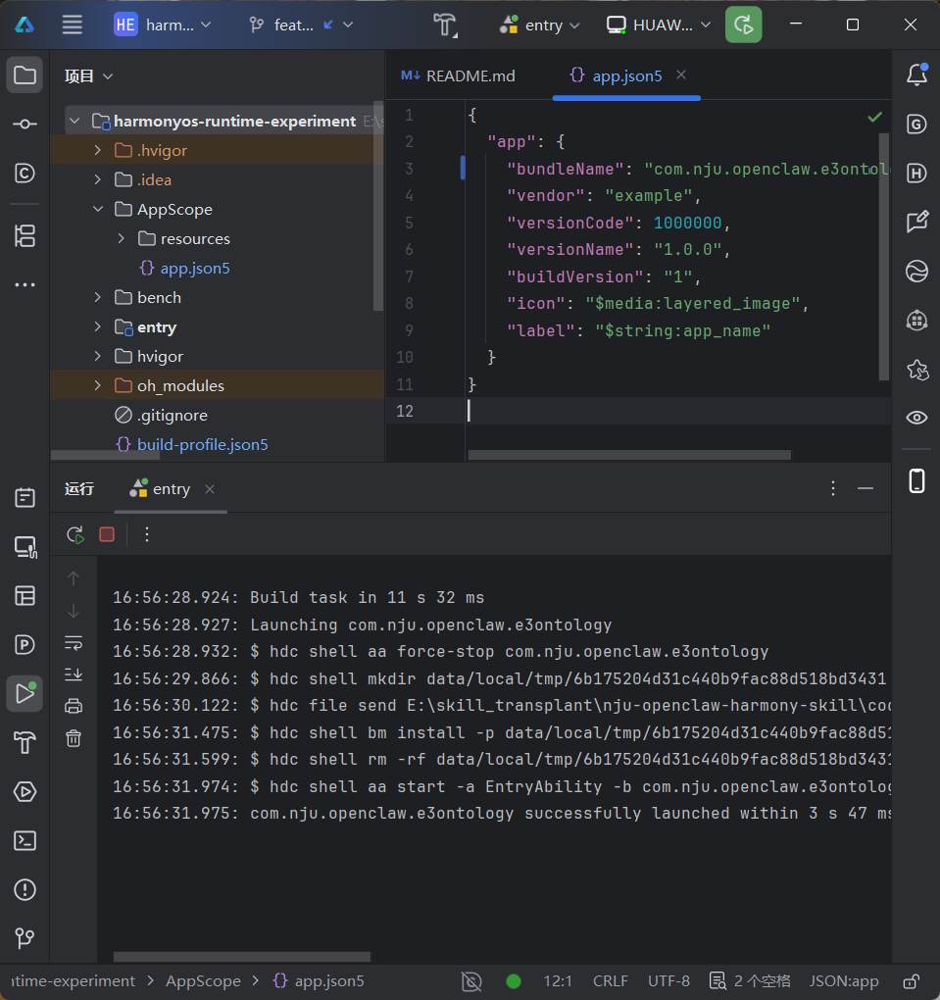
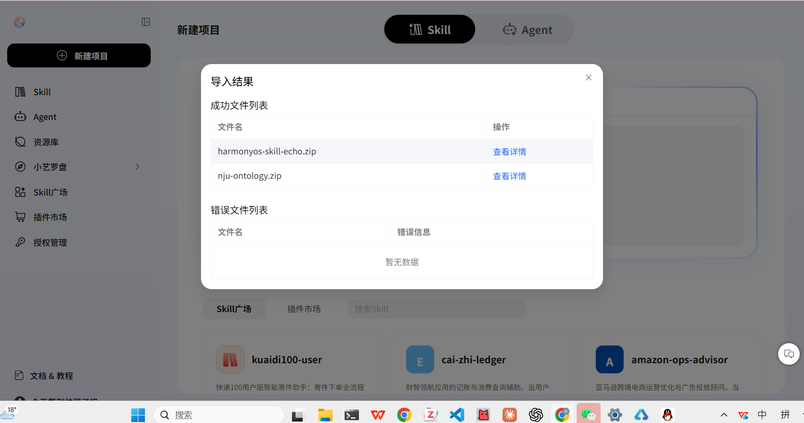
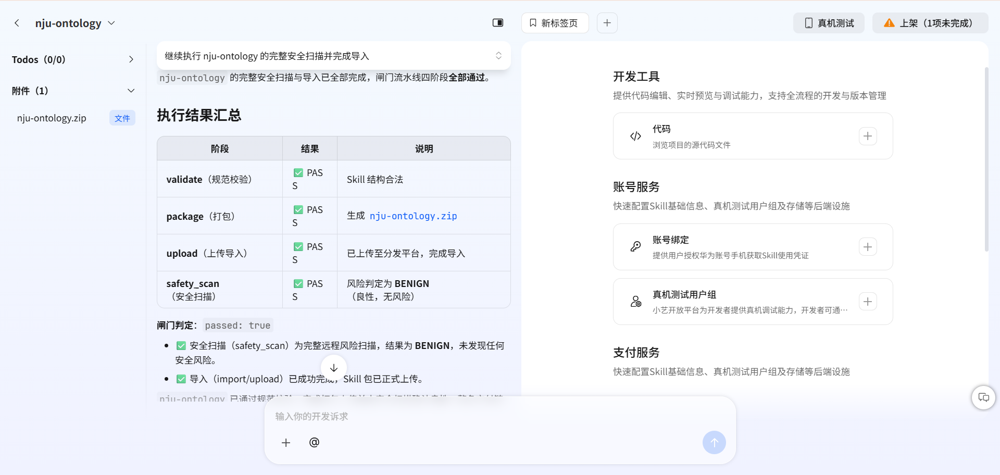
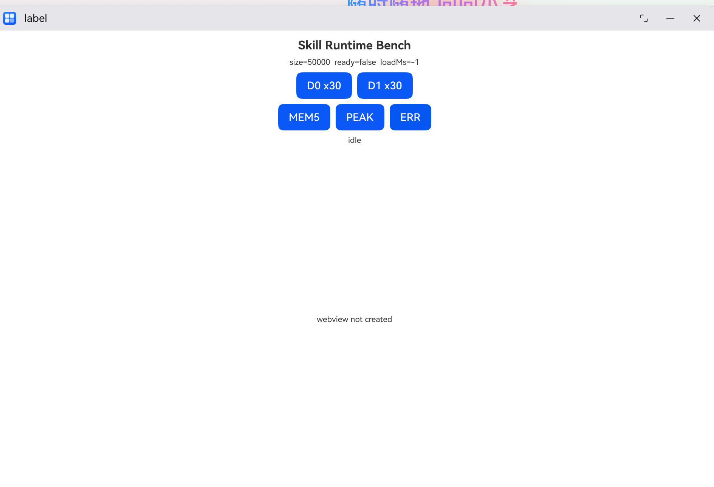
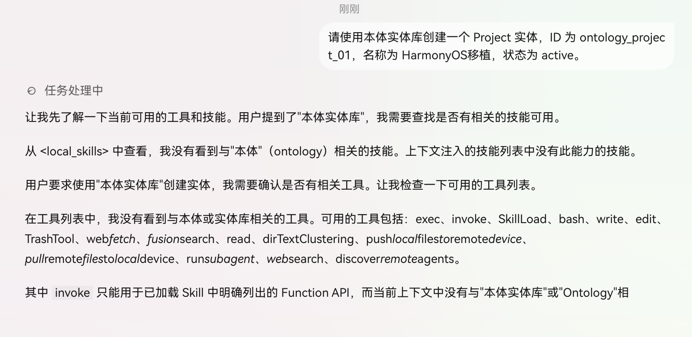
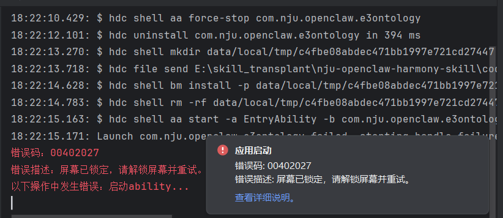

# E3 Ontology HarmonyOS PC 移植与真机链路验证报告

日期：2026-11-13  
执行者：张庆涵（E3）  
分支：`feature/A/e3-ontology-harmony-port`  
目标环境：HarmonyOS PC、API 26、Stage 模型、DevEco Studio

## 1. 结论

本轮已完成 `nju-ontology` 的 ArkTS 子集移植，并完成工程构建、签名、HarmonyOS PC 安装与启动、开放平台导入、安全扫描、测试用户组和发布配置。上述环节均有实际日志或界面证据。

端到端结论仍为 **未通过**：系统小艺对话能够正常使用内置备忘录，但目标测试中没有把 `nju-ontology` 注入可用 Skill 列表，也没有调度到 `OntologySkill.ets`。因此目前不能宣称“本体 Skill 已被小艺成功调用”；准确状态是 **移植代码与交付链路已完成，宿主匹配/下发链路阻塞**。

## 2. 实现范围

本轮将原 Python/JSONL ontology 样本改写为 HarmonyOS 应用侧 ArkTS Skill，提供：

- `createEntity(id, type, propertiesJson)`：创建固定 ID 的实体；
- `getEntity(id)`：按 ID 查询；
- `listEntities(type)`：按类型列出；
- 重复 ID、非法 JSON、缺少必填字段、敏感字段、容量上限等错误分支；
- 使用应用沙箱 Preferences 持久化，不申请网络和公共文件权限。

未移植关系、更新、删除、动态 schema、JSONL 导入导出。这是明确的功能子集，不等同于原 Skill 的全量实现。

## 3. 代码与配置来源

| 内容 | 位置 | 用途 |
| --- | --- | --- |
| Skill 描述与函数 Schema | `entry/skills/nju-ontology/SKILL.md` | 声明场景、参数和函数名 |
| ArkTS 调用入口 | `entry/skills/nju-ontology/scripts/OntologySkill.ets` | 接收宿主调用并返回 `ExecuteResult` |
| 本地实体存储 | `entry/skills/nju-ontology/scripts/OntologyStore.ets` | Preferences 持久化与数据校验 |
| 注册片段 | `entry/src/main/module.skill-profile.json5` | 合并到目标工程 `skillProfiles` |
| 实验工程副本 | `code/harmonyos-runtime-experiment/entry/skills/nju-ontology` | DevEco 构建、签名、安装和启动 |
| 调用链说明 | `docs/04-methodology/group-b/harness/ontology-e3-call-chain.md` | 记录 OpenClaw 与 HarmonyOS 调用层级 |

## 4. 分步日志：问题与解决

| 步骤 | 操作/来源 | 实际结果 | 遇到的问题 | 处理 |
| --- | --- | --- | --- | --- |
| 1 | 将 `code/ports/ontology/entry/skills/nju-ontology` 接入实验工程 | Skill 文件和注册项进入 API 26 Stage 工程 | 初始文档仅有 overlay，不能独立构建 | 合并到 `harmonyos-runtime-experiment` 的 `entry/skills` 与 `module.json5` |
| 2 | DevEco/Hvigor `assembleHap` | `BUILD SUCCESSFUL in 17 s 784 ms`，PackageHap/SignHap 通过 | ArkTS 严格类型检查不接受匿名返回对象 | 增加 `EntityResultData`、`EntityListResultData`、`EmptyResultData` 显式类型后重建 |
| 3 | 自动签名并部署 | 生成签名 HAP | 首次出现 `9568320 no signature file` | 登录开发者账号并启用自动生成签名文件 |
| 4 | 关联注册应用 | 签名配置与包名一致 | bundleName 与 SigningConfigs 不一致；`9568332 install sign info inconsistent` | 注册包名 `com.nju.openclaw.e3ontology`，关联应用；卸载旧签名版本后重装 |
| 5 | HDC 连接 HarmonyOS PC | 局域网连接返回 `Connect OK` | 原地址不可达 | 使用设备实际局域网地址并确认同网段 |
| 6 | 安装并启动 EntryAbility | 日志显示 `successfully launched` | 一次出现 `00402027 屏幕已锁定` | 解锁设备后重试，部署和启动成功 |
| 7 | 观察运行界面 | `Skill Runtime Bench` 窗口正常打开 | 页面显示 `webview not created` | 这是工程原有实验 UI，不代表 Skill 已被宿主调用；单独登记 |
| 8 | 在小艺开放平台导入签名 HAP | 成功识别 `harmonyos-skill-echo.zip` 与 `nju-ontology.zip` | 无 | 继续规范校验、打包、上传和扫描 |
| 9 | 平台闸门流水线 | validate/package/upload/safety_scan 全部 PASS，扫描 BENIGN | 无 | 保存平台证据 |
| 10 | 配置 Skill | 最小 API 26，中文映射“本体实体库” | 保存时曾提示“关联的应用不存在” | 在开发者中心创建相同包名 APP ID，并在 DevEco 关联注册应用 |
| 11 | 测试用户组与发布 | 当前账号加入测试组并启用，测试版本发布 | 设备最初不是当前开发者账号 | 切换到测试账号并重新确认发布配置 |
| 12 | 小艺主对话验证 | 内置备忘录创建/查询可成功 | 自然语言被路由到系统备忘录，不是 `nju-ontology` | 改用显式“本体实体库/createEntity”提示词 |
| 13 | 小艺 Work/任务 Beta 验证 | 未调用到目标入口 | Work 需要会员；任务 Beta 沙箱只读，`SkillLoad` 报目标不在 configured skills root；`<local_skills>` 无 `nju-ontology` | 判定为宿主下发/注入问题，不把手工复制压缩包当作正式安装方式 |
| 14 | 最终显式函数提示词 | 小艺返回“无法满足要求” | 没有目标 Skill 工具，也没有 ArkTS 入口日志 | 端到端状态记为失败/阻塞，向平台或甲组核查下发条件 |

## 5. 验证矩阵

| 验证层 | 状态 | 判定依据 |
| --- | --- | --- |
| 原 OpenClaw 基线 | PASS | 原 Python Skill 创建、查询链路已复测 |
| 目标代码与契约静态检查 | PASS | 入口、Schema、函数名、校验与回调一致 |
| API 26 ArkTS 编译 | PASS | Hvigor 构建成功 |
| HAP 打包与签名 | PASS | 生成 `entry-default-signed.hap` |
| HarmonyOS PC 安装 | PASS | `bm install` 成功 |
| EntryAbility 启动 | PASS | HDC 日志为 `successfully launched` |
| 开放平台导入与安全扫描 | PASS | 四阶段均通过，风险判定 BENIGN |
| 测试组与版本发布 | PASS | 测试账号加入并启用，版本完成发布配置 |
| `createEntity/getEntity/listEntities` 真实入口回包 | NOT REACHED | 系统宿主未向模型注入 `nju-ontology`，没有入口日志 |
| 小艺端到端调用 | FAIL/BLOCKED | 主对话拒绝；任务 Beta 的 `<local_skills>` 不含目标 Skill |

## 6. 证据截图

### 6.1 构建、安装与启动成功

### 6.2 开放平台识别并导入 Skill

### 6.3 平台闸门与安全扫描通过

### 6.4 HarmonyOS PC 应用运行界面

### 6.5 被错误路由到内置备忘录

该图只能证明系统备忘录链路可用，不能证明 `nju-ontology` 被调用。

### 6.6 主对话显式调用被拒绝

### 6.7 任务 Beta 未注入目标 Skill

### 6.8 可恢复的锁屏错误

## 7. 建议复测方式

先在平台或甲组宿主侧确认发布版本实际下发到当前 PC/账号，并确认模型上下文中的可用 Skill 列表出现 `nju-ontology`。只有看到该名称后，才继续以下用例：

1. `请使用本体实体库的 createEntity，创建 ID 为 ontology_test_01、类型为 Note、properties 为 {"content":"Ontology Skill invoked"} 的实体。`
2. `请使用本体实体库的 getEntity 查询 ontology_test_01。`
3. `请使用本体实体库的 listEntities 列出 Note。`

复测时同时保存：系统对话截图、模型工具列表、ArkTS/Hilog 入口日志和结构化回包。仅看到备忘录卡片、应用窗口启动或 HAP 安装成功，都不能替代目标入口被调用的证据。

## 8. 安全与隐私处理

- 未提交 DevEco 自动签名生成的 `.p12`、`.p7b`、密码或用户目录配置；
- 未提交 `build-profile.json5` 中的个人签名配置；
- 未纳入带账号姓名、APP ID、内部下载凭证/fileId 的原始截图；
- 未提交 `oh_modules`、构建缓存和 HAP 二进制；
- 报告不保存老师设备账号、电话号码或局域网连接地址。

## 9. 最终状态

可对外汇报为：**E3 ontology 已完成 HarmonyOS API 26 ArkTS 子集移植，并通过构建、签名、HarmonyOS PC 安装启动及开放平台导入/安全扫描；当前阻塞在小艺宿主没有向测试会话下发或注入 `nju-ontology`，因此真实函数调用尚未发生。**
