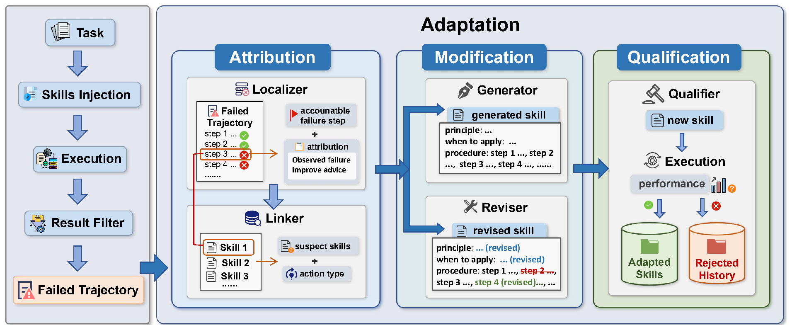

# SkillAdaptor 精读笔记

**论文**：SkillAdaptor: Self-Adapting Skills for LLM Agents from Trajectories（arXiv:2606.01311v1）
**作者**：Zhuoyun Yu, Xin Xie, Wuguannan Yao, Chenxi Wang, Lei Liang, Xiang Qi, Shumin Deng（浙江大学 / 蚂蚁数科 / 浙大-蚂蚁知识图谱联合实验室）
**阅读口径**：第一遍只抓 problem - method - result，读不懂的先跳过、进疑问清单。

---

## 1. 一句话摘要

SkillAdaptor 是一套**免训练**的智能体技能自适配框架：它把失败归因的粒度从"整条轨迹"**细化到"第一个可修复的错误步骤"**，只定点改写与之相关的技能条目，并在写回技能库前用**重跑对比**做准入检验，从而让**冻结**的基座模型在长程工具类任务上稳定涨点。

三行结果（相对同基座最强 baseline）：

- 最大单项提升：PinchBench Avg Score% **+1.5**（GLM-5）、Claw-Eval Avg Score **+1.8**（Kimi-K2.5）、WebShop 成功率 **+1.7 个百分点**（Kimi-K2.5）；WebShop 分数最多 **+2.3**（GLM-5，对比 EvoSkill）。
- 消融证明两个模块都不可省：去掉 Localizer+Linker，WebShop 成功率从 33.0% 掉到 28.6%；去掉 Qualifier 门禁，方差显著变大（PinchBench 从 ±5.2 变成 ±8.1）。
- 代价：每步提示更长（PinchBench 平均输入 token 13.9k→16.9k），但交互步数下降（Claw-Eval 7.3→5.8 步）。

---

## 2. 核心方法：1 张图 + 500 字讲清机制

**先看这张图怎么读**：左边一列是"跑任务的流水线"，右边 Adaptation 大框是"事后修技能的三段式"。从左到右就是一个完整闭环。

**前提**：模型参数全程冻结，唯一会变的是外挂的**文本技能库 K**。每条技能都写成 OpenClaw 风格的 SKILL.md 结构（标题 / 适用条件 / 行为原则 / 操作步骤 / 合格判据 / 反例），检索用 Qwen3-Embedding-8B 做向量召回（余弦阈值 0.45 取 top-10），再由基座模型按当前任务重排序后注入提示词。

**① 初始化与注入**：先让基座"裸奔"跑一批任务，只把**成功轨迹**蒸馏成初始技能库 K₀；之后每个任务都从 K 里检索注入技能再执行。注意图里的 Result Filter——**只有失败轨迹**会被送进右边的适配流程，成功的轨迹只当参考。

**② 归因 Attribution（本文最核心的一步）**：Localizer 先列 2–4 个候选错误步骤，从中选出"最早、且改掉它最有可能改善最终结果"的那一步 t\*，同时判断这是 skill_wrong（现有技能把人带偏了）还是 skill_missing（技能库没覆盖这个情况）。接着 Linker 把 t\* 和技能对上号，输出一个带权重的"嫌疑技能集"（责任权重 0.2–1.0），并决定下一步动作是 REVISE 还是 GENERATE。

**③ 改写 Modification**：若判定是技能误导，Reviser 只做**最小增量修改**——保留原来能用的部分，只补前置条件、消歧规则、反例和检查点；若判定是能力空缺，Generator 从失败上下文里新造一条可复用的技能。新技能还要过一道语义去重（与库内相似度 > 0.95 直接丢弃），防止技能库无限膨胀。

**④ 准入 Qualification**：候选更新**不直接入库**，而是拿旧库 K 和新库 K⁺ 各重跑一遍任务集，比较 Δ = E[M(q;K⁺)] − E[M(q;K)]，只有 Δ ≥ 0 才接受；否则回滚，把这次尝试扔进 Rejected History。这道"先验证再合入"的门禁是实验里方差变小的直接原因。

**⑤ 迭代控制**：最多 10 轮，技能库连续 3 轮没变就早停。全文的核心张力一句话概括：**把轨迹级的模糊信用分配，压成步骤级的可编辑片段。**

（以上机制描述 542 个中文字，不含图注与编号。）

---

## 3. 与我们课题的关系：鸿蒙系统上的 skill 移植

**我对课题的理解**（有偏差请纠正）：把原本面向桌面 / 云端 agent harness 的结构化技能（就是本文这种 SKILL.md 形态）**移植到鸿蒙（HarmonyOS）侧**，让技能在 ArkTS / 元服务 / 端侧设备这套环境里依然跑得起来，并且让"移植之后继续维护技能"这件事有可复用、可验证的流程。

如果你们说的其实是"把 SkillAdaptor 这套自适应框架整体搬到鸿蒙侧复现"，那下面 3.2 的第 1 条最关键，其余各条同样成立。

**先把两边的概念对上号**——这是我认为本节最有用的一张表：

| 论文里的概念 | 鸿蒙 skill 移植里的对应物 |
| --- | --- |
| 技能库 K（SKILL.md 结构） | 移植后的鸿蒙技能库，每条额外标注：适用 API 版本 / 设备形态 / 必需权限 |
| 失败轨迹 failed trajectory | 一次鸿蒙侧任务失败的调用链 + 日志 |
| 错误步骤 t\* | 真正卡住的那一步：调了不存在的 @ohos 接口、权限没声明、依赖 shell、路径不对 |
| skill_wrong（技能误导） | 技能本身没错，但在鸿蒙上会把人带偏（假设有 POSIX shell、假设能写全局路径） |
| skill_missing（能力空缺） | 鸿蒙特有场景没有技能覆盖（分布式软总线、卡片/元服务、授权弹窗的交互流程） |
| Reviser 的最小增量修改 | 只把那几行换成 @ohos.xxx、补权限声明、改成沙箱内路径，不动其余能用的部分 |
| Qualifier 的 Δ≥0 门禁 | 鸿蒙侧回归任务集重跑，且编译/静态检查必须过，才算这次移植合入 |
| Rejected History | 团队的"踩坑记录"：哪些移植改法试过不可行 |

### 3.1 能借鉴什么

1. **移植的正确形态就是"失败驱动的最小补丁"，本文正好给了完整范式。** 移植 skill 最容易犯的错是"看不懂就整条重写"，把本来能用的部分一起改坏。本文的循环——定位出错的那一步 → 映射到技能的具体字段 → 只改那个字段 → 重跑验证——几乎可以原样套到移植流程上。更妙的是**移植的失败点天然就是步骤级的**（某个接口不存在、某条权限没声明），正好落在这套方法最擅长的输入形态上。
2. **skill_wrong / skill_missing 这个二分，直接就是移植策略的分类器。** 前者走适配改写（Reviser），后者走新建鸿蒙特有技能（Generator）。建议移植工作一开始就给失败按这两类打标签，能立刻区分"是适配问题还是能力缺口"，避免两类问题混着做、越做越乱。
3. **"先验证再合入"是移植场景最该抄的一条。** 移植后的技能库如果缺了持续验证，会慢慢烂掉。把"候选技能 + 鸿蒙回归任务集重跑 + 通过才写入"做成硬门禁，比人肉 review 可靠得多。哪怕暂时没有自动判分，也至少保留"编译/静态检查必须过"这道最低门槛。
4. **schema 里 `when_to_apply` 这一栏，在移植场景价值翻倍。** 鸿蒙特有约束（API 版本、支持的设备形态、是否元服务、需要哪些权限、哪些 Kit 可用）应该全部写进适用条件，让技能自己声明"我在什么条件下才成立"，而不是把这些条件埋进 procedure 里。
5. **Rejected History 可以升格成团队知识资产。** 论文只把它当成"被拒绝的更新记录"，但移植场景里"哪些改法试过不行"（例如某 Kit 在某版本上不可用、某权限在元服务里拿不到）价值极高，值得单独沉淀，并在下一次归因时作为上下文喂回模型。
6. **实验报告规范值得直接抄。** 均值 ± 多次独立重复的方差、组件消融（去掉归因模块 / 去掉验证门禁 / 只用初始技能）、效率双指标（token 与交互步数一起看）——这套写法可以直接作为我们写实验部分的模板。

### 3.2 哪里不适用 / 要当心

1. **前置条件对不上：它需要挂在 harness 上，鸿蒙侧未必有。** 论文里它是 plug-in，插进 OpenClaw-class 的 harness；它的输入是"执行轨迹"，也就是结构化的 tool call / observation 日志。**如果鸿蒙侧还没有一套可观测的工具调用层，这套方法根本没有输入。** 这可能是我们课题里第一件要解决的事。另外"移植后的工具"到底指什么也得先定义清楚（ArkTS 调用系统能力？还是某个 Agent 平台暴露的意图/技能接口？）。
2. **反馈信号质量差是最大的风险。** 作者在 Limitations 里承认：反馈稀疏、延迟，或缺少外部接口时方法会变弱。而鸿蒙侧的验证要么很快（编译、静态检查），要么极慢（真机部署、签名、权限授权、跨设备协同）。涉及 UI 交互或授权流程的技能，反馈环很长，Localizer 拿不到可靠信号——而论文的增益恰恰只来自"失败能定位到明确中间决策"的任务。
3. **很多移植失败根本不是技能的错，但本文的失败分类里没有这一类。** 权限没批、签名不对、设备/Kit 版本不匹配、技能市场审核限制，这些是**环境问题**而不是技能缺陷。硬把它们塞进技能更新流程，技能库会被污染且越改越偏。我们必须在归因之前补一道"环境问题 vs 技能问题"的分类过滤——这是论文没覆盖、需要我们自己做的一块。**（我认为这是分享时最值得抛出来讨论的一点。）**
4. **没有现成基准，Δ≥0 这条门禁抄不过来。** 论文的三个基准都是 OpenClaw 桌面工具链，鸿蒙上没有等价 benchmark，也没有现成 grader。要做这道门禁，得先自建"鸿蒙任务集 + 自动判分"，这本身就是课题里一大块独立工作量，别当成免费附赠。DevEco 的测试框架能不能承担判分，建议尽早验证。
5. **端侧跑检索和归因会整体降级。** 论文的检索用 Qwen3-Embedding-8B、归因改写用顶级基座模型，都是云端假设。若目标是端侧/离线鸿蒙，两块都得换成端侧可跑的小模型，本文那点增益（+1~2 分）很可能撑不过模型能力的下降，需要重新验证。**甚至可能得出"端侧不值得做步骤级归因"这个反向结论——那也是很有价值的结论。**
6. **"同一个模型自评自改"的偏差，在移植场景会被放大。** 模型对鸿蒙 API 的知识本身就可能过时或干脆是幻觉（写出不存在的 @ohos 接口、记错权限名）。让同一个模型既写技能、又判定技能对不对，**等于把幻觉直接固化进技能库**。这里必须引入独立裁判：编译器、静态检查、真机执行结果的优先级都高于模型的自我判断。
7. **成本模型完全不同。** 桌面 harness 上重跑一轮任务集是分钟级；鸿蒙上要过模拟器启动、真机部署、签名，可能是小时级。论文是"每轮适配都重跑一遍"，这个节奏在鸿蒙侧基本跑不动，得改成"攒够一批改动再验证"或抽样验证。

### 3.3 一句话结论

能直接搬的是**方法论骨架**（步骤级归因 → 最小补丁 → 验证后合入）；不能直接搬的是**它的前提**（现成 harness、可观测轨迹、廉价可重复的评测、云端大模型）。所以我判断，我们课题里真正要自己造的是这三块：**可观测的执行轨迹、便宜的鸿蒙侧判分、以及"环境问题 vs 技能问题"的前置分类。**

---

## 4. 疑问清单（分享时抛给大家讨论）

**关于方法假设**

1. **"单一责任步"的假设站得住吗？** 论文假设存在唯一的"最早可修复错误步骤" t\*。但长程任务里更常见的是**几个小错累积**导致最后崩盘。如果失败由 3 个弱错误共同造成，Linker 输出的权重会被摊薄，会不会"改哪一条都没用"？消融里去掉 Localizer+Linker 掉 4.4 分证明了方向是对的，但**没有回答多错因场景**。这是我最想讨论的一点。
2. **Linker 的权重是怎么"训"出来的？** 权重 0.2–1.0 完全由 LLM 在 prompt 约束下生成，没有校准、没有标注验证。同一份失败轨迹换一次采样（温度 0.9）会不会给出不同的嫌疑技能集？论文没做这种稳定性测试。

**关于评测与结论强度**

3. **Δ ≥ 0 有统计显著性吗？** PinchBench base 是 63.6±8.7，而最大增益 1.5 分。如果把"接受/拒绝一次技能更新"当成一个假设检验，作者用的阈值是 0，等于**默认零噪声**。这意味着被接受的更新里可能混着噪声，而被拒绝的也可能是真信号。为什么不用置信区间下界或者多轮重复的配对检验？
4. **"training-free" 这个词会不会有点滑？** 参数确实冻结，但技能库迭代本质是**自蒸馏**；再加上 Qualifier 的重复 rollout，整体推理开销是 base 的几倍？论文给了 token 和步数，却**没有给总成本/wall-clock 或"值不值"的取舍分析**。

**关于可复现性与边界**

5. **技能库会不会漂移？** 参考文献里就有一篇专门讲 Library Drift（Zhang et al., 2026b），但本文的防线只有两条：嵌入去重（0.95）+ Δ≥0 门禁。跑到第 10 轮会不会出现语义冲突、或者**过拟合到适配任务集**？另外，适配阶段用了多少任务、任务分布怎么选的，正文没写清（WebShop 是 1624 训练实例，PinchBench/Claw-Eval 的适配集规模不明）——这直接影响复现成本。
6. **增益只有 +1~2 分，是不是有更简单的追赶方式？** 和 EvoSkill 在 WebShop 上只差 1.2 分左右。有没有做过"技能数量 vs 归因质量"的解耦实验？比如单纯把 top-k 检索调大、或者只做"成功轨迹蒸馏 + 手动加检查点"，能不能追平大部分增益？
7. **为什么在 Research/Memory/Security 类任务上几乎没收益？** 作者的归因是"依赖持久状态"。那么这类任务需要的到底是**技能更新**还是**跨会话记忆更新**？如果我们的场景正好落在这一类，替代路线应该选哪条（A-Mem 式记忆？还是 workflow 级而非技能级更新？）

**专门针对我们课题（鸿蒙 skill 移植）的问题**

8. **移植的对象到底是什么粒度？** 是"技能条目"逐个移植，还是"技能库 + 适配器 + harness"整套搬过去？如果是整套，鸿蒙侧有没有等价的 agent harness（工具接口、执行沙箱、观测层）？没有 harness，SkillAdaptor 这类方法**插不进去**——这一条得先确认，否则后面全是空谈。
9. **鸿蒙侧的执行轨迹从哪来？** 现在有没有 tool call / observation 级别的日志埋点？如果没有，是先补可观测层，还是先退化成"只拿编译错误和异常栈做归因"？退化成后者的话，归因粒度还剩多少价值？
10. **鸿蒙技能的成功/失败谁来判？** 如果只能人工判定，Qualifier 门禁实际上就不可行，是不是要改成"编译门槛 + 抽样人工复核"？判分自动化程度直接决定这套方法在我们课题里能不能成立。
11. **哪些技能压根不值得移植？** 依赖 POSIX shell、桌面文件系统、浏览器 DOM 的那类技能在鸿蒙上基本没救。能不能先做一次"可移植性筛查"，把明显不可移植的排除在外，省掉后面的无效归因？
12. **会不会攻错了瓶颈？** 如果移植失败的主要原因是"模型不懂鸿蒙 API"（知识问题），那需要的可能是可靠的官方文档检索 + 编译反馈，而不是步骤级技能归因。**换句话问：我们课题的核心难点，究竟在"技能写错了"还是"模型不知道鸿蒙怎么用"？** 这两个答案会导向完全不同的技术路线。

**第一遍读跳过、需要确认的地方**

- 附录 B.2 中 Claw-Eval 的 "Overall Dimension" 聚合协议细节（各任务类别怎么加权）没细看，可能会影响跨基准比较的公平性。
- 图 3 右轴 Δscore 的具体计算方式（相对 bare-LLM 还是相对上一轮）文中表述略含糊。
- 论文标注 "The code will be released at github.com/zjunlp/SkillAdaptor"，**截至阅读时未发布**，所以上面所有数字都无法独立验证。

---

## 附录：关键数字速查

| 基准 | 指标 | Base | 最强 baseline | SkillAdaptor | 备注 |
| --- | --- | --- | --- | --- | --- |
| WebShop | Succ% (Kimi-K2.5) | 24.6±1.5 | 31.3 (EvoSkill) | **33.0±1.1** | 涨 1.7 个点 |
| WebShop | Score (Kimi) | 32.1±1.4 | 40.4 (EvoSkill) | **41.6±0.5** | GLM-5 上 +2.3 |
| PinchBench | Avg Score% (Kimi) | 63.6±8.7 | 66.0 (OpenSpace) | **67.2±5.2** | 方差明显收窄 |
| PinchBench | Avg Score% (GLM-5) | 70.2±5.4 | 72.3 (OpenSpace) | **73.8±4.6** | 最大增益 +1.5 |
| Claw-Eval | AvgScore (Kimi) | 73.2±1.3 | 74.0 (OpenSpace) | **75.8±1.6** | 最大增益 +1.8 |

**组件消融（Kimi-K2.5）**

| 配置 | WebShop Succ% | PinchBench Avg% | Claw-Eval AvgScore |
| --- | --- | --- | --- |
| (0) 无技能库 | 24.6 | 63.6 | 73.2 |
| (1) 完整方法 | **33.0** | **67.2** | **75.8** |
| (2) 去掉 Localizer & Linker | 28.6 | 65.3 | 74.5 |
| (3) 去掉 Qualifier 门禁 | 26.3（方差↑） | 65.8（±8.1） | 74.2（±2.7） |
| (4) 只用初始技能、不做归因更新 | 25.3 | 64.1 | 73.9 |

**效率（Kimi-K2.5，每任务平均）**

| 基准 | 输入 token（Base→本文） | 交互步数（Base→本文） |
| --- | --- | --- |
| WebShop | 1507 → 2651 | 18.9 → 15.5 |
| PinchBench | 13927 → 16902 | 10.4 → 9.8 |
| Claw-Eval | 11470 → 13933 | 7.3 → 5.8 |
