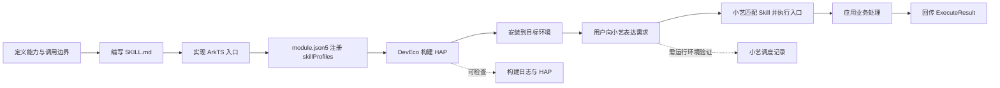

# DevEco Studio 自建 HarmonyOS Skill 全链路教程

> 适用对象：HarmonyOS API 26.0.0、Stage 模型、DevEco Studio；以团队 `harmonyos-skill-echo` 示例为例。  
> 目标：从 Skill 契约编写、工程注册、ArkTS 入口实现、构建安装，到系统智能体调用与留证。  
> 状态：工程侧流程可按本文复现；小艺系统调度步骤须在支持的设备/模拟器上实测，不能用“构建成功”替代。

## 1. 全链路概览



**两个验证层次：**

1. **工程层**：目录、契约、配置、ArkTS 编译、HAP 生成和应用安装。
2. **调度层**：系统智能体发现 Skill、理解触发场景、填充参数、调用入口并呈现结果。只有实际观察到调用和返回，才能记为调度成功。

## 2. 开发前检查

- 工程使用 **Stage 模型**，不是 FA 模型。
- `targetSdkVersion` 与 `compatibleSdkVersion` 至少满足当前 Skill 接口要求（本示例使用 26.0.0）。
- DevEco 安装了相应 HarmonyOS SDK；构建时检查实际选择的 SDK/API，而不是只看电脑上是否存在多个 SDK。
- 模块清单位于 `entry/src/main/module.json5`。
- 先确定一个边界清楚、容易判定结果的最小能力，例如原样回显一段文本。

Skill 能力从 API 26.0.0 起由 Ability Kit 提供，官方指南限定 Stage 模型。详细接口约束见[官方 ArkTS 应用 Skill 开发指导](https://developer.huawei.com/consumer/cn/doc/doccenter-capabilities/arkts-skill-development-guide)。

## 3. 建立 Skill 文件结构

官方目录约定在模块下建立 `skills/<skill-name>/`，至少包含描述文件和 `scripts/` 中的 ArkTS 入口：

```text
entry/
├── skills/
│   └── harmonyos-skill-echo/
│       ├── SKILL.md
│       └── scripts/
│           └── EchoSkill.ets
└── src/main/
    ├── ets/entryability/EntryAbility.ets
    └── module.json5
```

`name` 应稳定、唯一，并在 `SKILL.md` 和 `skillProfiles` 中保持一致。入口函数名、参数描述和返回值契约应相互对应。

## 4. 编写 SKILL.md 契约

描述文件至少应让智能体知道：

- Skill 的唯一名称和用途；
- 哪些用户表达应触发，哪些不应触发；
- 每个场景的 `functionName`；
- 参数名称、类型、含义、必填约束及示例；
- 成功、失败和边界情况的返回值结构。

以回显为例，触发话术可以是“回显 hello”，参数为 `arg1: string`，返回 `data.message`。不要在描述里承诺尚未实现的功能。

## 5. 实现 ArkTS 入口

入口脚本需要导入 `scriptManager`，导出默认类，并提供与契约一致的 `public async` 方法。方法第一个参数接收 `ArkTSScriptInfo`，其余参数承接智能体传入的业务参数；执行结束后通过 `completeArkTSScriptInApp` 回传 `ExecuteResult`。

团队当前 `EchoSkill.ets` 的关键模式：

```ts
import { scriptManager } from '@kit.AbilityKit';

export default class EchoSkill {
  public async echo(info: scriptManager.ArkTSScriptInfo, ...argv: string[]): Promise<void> {
    const message = argv[0] ?? 'Hello from the HarmonyOS Skill demo.';
    const result: scriptManager.ExecuteResult = {
      code: 0,
      result: { type: 'result', status: 'success', data: { message } }
    };
    await scriptManager.completeArkTSScriptInApp(info.context, info.requestCode, result);
  }
}
```

实际工程还应校验空参数、异常和返回契约；以上片段展示调用骨架，不代替项目内完整实现。具体类型和调用细节以官方文档及当前 SDK 声明为准。

## 6. 在 module.json5 注册 Skill

在 `module` 下配置 `skillProfiles`，使 `name`、关联 Ability 和脚本入口对应起来：

```json5
"skillProfiles": [
  {
    "name": "harmonyos-skill-echo",
    "abilityName": "EntryAbility",
    "srcEntries": [
      "../../skills/harmonyos-skill-echo/scripts/EchoSkill.ets"
    ],
    "version": "1.0.0"
  }
]
```

检查相对路径是从 `entry/src/main/module.json5` 所在位置解析，并确认 `abilityName` 对应模块中真实存在的 Ability。配置错误通常会在构建阶段暴露，但构建成功本身仍不证明系统已完成语义发现或调用。

## 7. 构建、安装与检查

1. 在 DevEco 打开 HarmonyOS 工程，核对产品 SDK 与模块配置。
2. 运行 Build/Hvigor 构建 HAP，保存构建日志和产物路径。
3. 检查警告与错误，特别是 API 版本、Skill 入口文件、类型声明和签名状态。
4. 将 HAP 安装到可用的 API 26 环境并启动应用，先验证应用自身能正常运行。
5. 记录运行环境型号、系统版本、API 版本、构建时间、HAP 版本和安装结果。

如果模拟器允许未签名 HAP 安装，可按 IDE 提示跳过签名；该结果只适用于模拟器验证。系统智能体能力是否可用，要单独确认。

## 8. 尝试小艺调用并留证

1. 确认目标环境中确实存在可交互的小艺入口；若入口不存在，记录环境限制，不要记作 Skill 调用失败或成功。
2. 使用与 `SKILL.md` 触发场景一致的短话术，例如“请回显 hello”。
3. 观察是否出现应用 Skill 调用/执行提示，以及返回文本是否为 `hello`。
4. 重试至少 3 次，改变输入文本，并加入一个不应触发的负例话术。
5. 保存调用前配置、触发语句、系统响应、应用日志（若可见）、时间戳和失败现象。
6. 在实验记录中区分：**入口可用、Skill 被匹配、脚本执行、返回值呈现**四个检查点。

官方开发指导描述了系统智能体依据描述文件进行意图与能力匹配；实际产品/模拟器是否开放该调度链路，应由实验确认。

## 9. 常见问题定位

| 现象 | 优先检查 |
|---|---|
| API/接口找不到 | SDK/API 版本、Ability Kit 导入、目标 API 声明 |
| Skill 入口文件未找到 | `srcEntries` 相对路径、文件名大小写、文件是否纳入模块 |
| Skill 不触发 | `name` 是否一致、场景描述是否明确、参数 Schema 是否可解析、目标环境是否支持系统 Skill 调度 |
| 脚本执行但没有回复 | 是否调用 `completeArkTSScriptInApp`、requestCode/context 是否沿用入口参数、返回结构是否匹配 |
| HAP 能构建但不能安装 | 目标 API/系统版本、签名、设备能力及安装日志 |
| WebView/JS 页面不执行 | `@kit.ArkWeb`、本地 rawfile 路径、JS 开启配置与 JSBridge；这属于应用内部实现，不等同于非 ArkTS Skill 入口 |

## 10. 本团队 Echo 工程对照

当前工程已经具备：

- `entry/skills/harmonyos-skill-echo/SKILL.md`；
- `entry/skills/harmonyos-skill-echo/scripts/EchoSkill.ets`；
- `entry/src/main/module.json5` 中的 `skillProfiles` 注册；
- API 26.0.0 构建配置（以当前本地文件为准）；
- 已有过 HAP 构建成功记录。

因此近期工作重点是保存可复现的构建证据，并验证目标模拟器是否提供小艺调用入口。不要把历史构建通过记录表述为当前模拟器调度已通过。

## 参考资料

- [基于 ArkTS 脚本的应用 Skill 开发指导](https://developer.huawei.com/consumer/cn/doc/doccenter-capabilities/arkts-skill-development-guide)
- [应用侧调用前端页面函数（ArkWeb）](https://developer.huawei.com/consumer/cn/doc/HarmonyOS-Guides/web-in-app-frontend-page-function-invoking)
