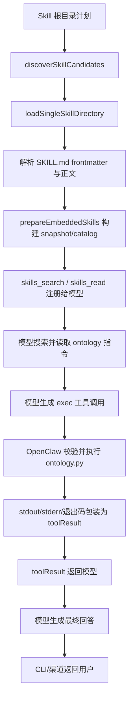

# E3 Harness 调用链说明：ontology

## 1. 范围与版本

- 案例：`oswalpalash/ontology` v1.0.4。
- 本机 OpenClaw：2026.10.4（383c124），安装于 `D:\OpenClaw\npm-global\node_modules\openclaw`。
- 源码定位参考：仓库已有源码地图固定到 OpenClaw commit `520302d8ee6`；本机发布包为打包后的 `dist/*.mjs`，文件名带内容哈希，适合验证运行构件，不适合作为稳定源码链接。

## 2. 关键源码位置

| 阶段 | 文件/函数 | 作用 |
| --- | --- | --- |
| 来源计划 | `src/skills/loading/workspace-skill-sources.ts` / `resolveWorkspaceSkillSourcePlan` | 计算 bundled、managed、personal、workspace 等 Skill 根目录和层级 |
| 候选发现 | `src/skills/loading/skill-root-discovery.ts` / `discoverSkillCandidates` | 扫描根目录并找出含 `SKILL.md` 的候选目录 |
| 单 Skill 加载 | `src/skills/loading/local-loader.ts` / `loadSingleSkillDirectory` | 读取 `SKILL.md`、解析 frontmatter、检查 name/description、构造 Skill |
| 运行时准备 | `src/agents/embedded-agent-runner/skill-runtime.ts` / `prepareEmbeddedSkills` | 为一次 Agent run 生成 snapshot、prompt 和 installed catalog |
| Skill 工具注册 | `src/agents/tools/installed-skill-tools.ts` / `createInstalledSkillTools` | 注册 `skills_search` 和 `skills_read` |
| 全部工具组装 | `src/agents/openclaw-tools.ts` | 把 Skill 搜索/读取及 exec 等允许工具交给模型 |
| Skill 使用提示 | `src/agents/system-prompt-skills.ts` | 告诉模型何时搜索、读取 Skill；读取不等于执行 |
| 显式命令 | `src/skills/discovery/chat-command-invocation.ts` / `resolveSkillCommandInvocation` | 解析 `/skill` 等显式调用路径 |
| 工具执行循环 | 发布包 `dist/agent-core-*.mjs` 及工具适配层 | 接收模型 tool call，执行对应工具，构造 `toolResult` 再送回模型 |
| 用户呈现 | Agent run/回复投影与 channel 层 | 将最终 assistant 内容及可见工具结果返回 CLI/用户渠道 |

## 3. 调用流程

## 4. E3 实际运行路径

旧模型 `qwen2.5:7b` 的普通文本生成可用，但会把 Skill 名称误当成 callable tool，或声称运行成功却没有文件，因此失败发生在“模型选择工具/参数生成”层。更换 `qwen3.5:4b-q4_K_M` 后：

1. Agent 读取 ontology `SKILL.md`；
2. Agent 选择 `exec`，调用 `scripts/ontology.py`；
3. Windows PTY 不可用时 OpenClaw 自动回退到非 PTY；
4. 第一次参数错误产生随机 ID，Agent 随后用正确 `--id` 修正；
5. OpenClaw 将脚本结果返回模型，模型生成完成说明；
6. 外部再以文件内容和 `get --id` 退出码验收，避免只相信模型文字。

这说明 Skill 本身不是工具；它先进入模型可读的 catalog/上下文，真正执行依赖宿主提供的 `exec`、文件系统、Python 和进程结果回传。

## 5. 移植到 HarmonyOS 时的宿主能力替换

| OpenClaw Harness 能力 | ontology 的使用 | HarmonyOS 替换/补齐 |
| --- | --- | --- |
| Skill 目录扫描与 frontmatter 加载 | 发现 ontology | `module.json5.skillProfiles` 静态注册 + 系统语义匹配 |
| `skills_search` / `skills_read` | 模型按需读取完整说明 | HarmonyOS `SKILL.md` 的场景、Schema 和函数契约 |
| 模型自由选择 `exec` | 调用 Python CLI | `ohos-arkTSScript` 定向调用 `.ets` 的固定公开方法 |
| Python 3 + PyYAML | 解析参数、图操作和 schema | ArkTS 业务代码；本子集不依赖 PyYAML |
| 工作区文件系统/JSONL | 持久化实体历史 | 应用沙箱 Preferences；不暴露任意路径 |
| 子进程 stdout/stderr/exit code | 工具执行结果 | `scriptManager.ExecuteResult` + `completeArkTSScriptInApp` |
| OpenClaw 工具权限与路径限制 | 控制写入范围 | 应用沙箱、静态权限声明和 Skill 调用权限 |
| Agent 重试与自我修正 | 修正错误 CLI 参数 | 入口必须自行校验参数，不能把安全性寄托于模型重试 |

## 6. 关键结论

1. OpenClaw 的 Skill 加载、模型选择、工具执行和结果回传是分层机制；“Skill 已加载”不能证明脚本执行。
2. ontology 的核心宿主依赖不是 Python 语法本身，而是结构化调用、持久化、参数校验和结果回传。
3. HarmonyOS 应用 Skill 把开放式多步执行收缩为固定函数回调，降低了任意命令/路径风险，但也失去动态 CLI 组合能力。
4. 移植验收必须分别记录：注册/构建、应用运行、Skill 匹配、ArkTS 入口执行和结果呈现。
5. 当前本机只完成目标代码和静态映射；没有 DevEco/Hvigor，因此不能声明已构建或已运行。

